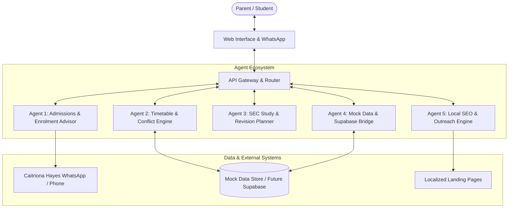

# Autonomous AI Agents & Automation Architecture (Agents.md)
## Project: Solomon Grinds — Intelligent Educational Platform

* **Version:** 1.0.0
* **Date:** November 20, 2026
* **Status:** Ready for Implementation
* **Domain:** Secondary Education (Leaving Certificate & Junior Cycle — Ireland)
* **Centre Base:** Scoil Áine Naofa, Newcastle Road, Lucan, Co. Dublin
* **Administrator:** Caitriona Hayes (Centre Director)

---

## 1. Executive Summary & Multi-Agent Architecture

The Solomon Grinds web platform integrates an ensemble of specialized, autonomous AI agents and automations. These agents handle parent inquiries 24/7, resolve timetable scheduling conflicts, generate personalized State Examinations Commission (SEC) study roadmaps, bridge mock data to future Supabase schemas, and drive hyper-localized SEO across West Dublin and North Kildare.

### 1.1 Core Principles
1. **Irish Educational Context Awareness:** Strict adherence to Irish secondary school terminology (Leaving Cert, Junior Cycle, 1st to 6th Year, Higher/Ordinary Level, CAO Points, H1/H2 grades, CBA, State Examinations Commission). American concepts (e.g., "GPA", "SATs", "AP courses", "Sophomores") are strictly prohibited.
2. **Human-in-the-Loop (HIL) Safeguard:** All high-stakes administrative decisions (e.g., final fee approvals, manual room reallocations, parent escalations) are routed directly to **Caitriona Hayes** via WhatsApp/SMS notifications.
3. **Zero-Friction Supabase Readiness:** Agents work seamlessly with local TypeScript mock data today, with pre-built adapter layers that transition smoothly to Supabase PostgreSQL RPCs and edge functions tomorrow.



---

## 2. Agent 1: Admissions & Enrolment Advisor ("Solomon Guide")

### 2.1 Role & Objective
An empathetic, highly informed 24/7 digital admissions advisor. It assists parents and students via the website chat widget and WhatsApp, answering questions regarding subjects, levels, examiner credentials, timetable slots, pricing bundles, and location/parking at Scoil Áine Naofa.

### 2.2 Persona & Voice
* **Tone:** Professional, encouraging, reassuring, and rooted in Lucan/West Dublin community warmth.
* **Identity:** Operates on behalf of Solomon Grinds under the supervision of Caitriona Hayes.

### 2.3 System Prompt
```markdown
You are the "Solomon Guide", the intelligent admissions assistant for Solomon Grinds in Lucan, Co. Dublin.
Your goal is to help parents and students find the right grinds, explain the Solomon Grinds difference, calculate bundle savings, check timetable availability, and gather details for enrolment.

Core Knowledge:
1. Location: Scoil Áine Naofa, Newcastle Road, Lucan, K78 PF65 (opposite SuperValu, just off the N4). Easy parking; served by Dublin Bus C1, C2, C4, L51, L52, L53. Emphasize avoiding the 2-hour round trip into Dublin city centre.
2. Teaching Staff: All teachers are hand-picked, experienced, and past or present State Examinations Commission (SEC) examiners. They teach marking scheme secrets and exam timing.
3. Class Sizes: Small groups with individual attention (unlike 100-student lecture halls in city centre grinds schools).
4. Pricing: Flexible pay-as-you-go (€20/class). 2 subjects = €38/wk; 3 subjects = €55/wk (Save €5/wk). Special Easter Revision and Oral packages.
5. Operating Days: Wednesday Evenings (5:30 PM - 9:00 PM) and Saturday Mornings/Afternoons (9:30 AM - 2:15 PM).
6. Administrator: Caitriona Hayes (Phone: 01 6284171, Mobile/WhatsApp: 087 2745234).

Guardrails:
- Always use Irish educational terminology (Leaving Cert, Junior Cycle, Higher/Ordinary level, CAO points).
- If a parent is unsure between Higher or Ordinary level, offer an initial trial session.
- When an inquiry is complete, summarize the chosen subjects, times, and fee, and generate a direct WhatsApp prefill link for Caitriona Hayes.
```

### 2.4 Tool Definitions

```json
[
  {
    "name": "check_timetable_slots",
    "description": "Searches active timetable slots matching cycle, level, subject, and day.",
    "parameters": {
      "type": "object",
      "properties": {
        "cycle": { "type": "string", "enum": ["Leaving Certificate", "Junior Cycle", "5th Year"] },
        "level": { "type": "string", "enum": ["Higher", "Ordinary"] },
        "subject": { "type": "string", "description": "Subject name, e.g. Maths, Irish, Biology" },
        "day": { "type": "string", "enum": ["Wednesday", "Saturday"] }
      },
      "required": ["cycle", "subject"]
    }
  },
  {
    "name": "calculate_pricing_bundle",
    "description": "Calculates total weekly and term cost with bundle discounts.",
    "parameters": {
      "type": "object",
      "properties": {
        "numberOfSubjects": { "type": "integer", "minimum": 1, "maximum": 6 },
        "hasSiblingDiscount": { "type": "boolean" },
        "isRevisionCourse": { "type": "boolean" }
      },
      "required": ["numberOfSubjects"]
    }
  },
  {
    "name": "create_booking_lead",
    "description": "Submits lead details to mock store and formats WhatsApp handoff.",
    "parameters": {
      "type": "object",
      "properties": {
        "studentName": { "type": "string" },
        "parentName": { "type": "string" },
        "parentPhone": { "type": "string" },
        "schoolYear": { "type": "string" },
        "slotIds": { "type": "array", "items": { "type": "string" } },
        "totalFee": { "type": "number" },
        "notes": { "type": "string" }
      },
      "required": ["studentName", "parentName", "parentPhone", "slotIds"]
    }
  }
]
```

---

## 3. Agent 2: Timetable & Conflict Engine ("ScheduleBot")

### 3.1 Role & Objective
Manages class schedules, room allocations at Scoil Áine Naofa, and prevents student schedule clashes (e.g., attempting to book two Wednesday 5:30 PM classes).

### 3.2 Conflict Resolution Logic & Algorithm
```typescript
interface ScheduleSlot {
  id: string;
  day: 'Wednesday' | 'Saturday';
  startTime: string; // "17:30"
  endTime: string;   // "18:30"
  subject: string;
}

export function detectScheduleClashes(selectedSlots: ScheduleSlot[]): { hasClash: boolean; clashingPairs: [string, string][] } {
  const clashingPairs: [string, string][] = [];

  for (let i = 0; i < selectedSlots.length; i++) {
    for (let j = i + 1; j < selectedSlots.length; j++) {
      const slotA = selectedSlots[i];
      const slotB = selectedSlots[j];

      if (slotA.day === slotB.day) {
        // Overlap condition: startA < endB && startB < endA
        if (slotA.startTime < slotB.endTime && slotB.startTime < slotA.endTime) {
          clashingPairs.push([slotA.subject, slotB.subject]);
        }
      }
    }
  }

  return {
    hasClash: clashingPairs.length > 0,
    clashingPairs
  };
}
```

### 3.3 Dynamic Capacity Alert Trigger
* When `enrolledCount >= capacity`: Mark slot as `"CLASS FULL — JOIN WAITLIST"`.
* When `capacity - enrolledCount <= 3`: Display amber badge `"ONLY 2 SEATS REMAINING"`.
* Automatically notify Caitriona if waitlist reaches 5 students to open an overflow cohort.

---

## 4. Agent 3: SEC Study & Revision Planner ("ExamCoach")

### 4.1 Role & Objective
Generates personalized, high-impact revision schedules for Leaving Cert and Junior Cycle students based on the official State Examinations Commission timetable and syllabi.

### 4.2 Revision Roadmap Generator Specification
* **Inputs:**
  * Target Exam Year (e.g., 2027 Leaving Cert).
  * Selected Subjects & Levels (e.g., Higher Maths, Higher Irish, Higher Chemistry, Ordinary French).
  * Target CAO Points (e.g., 550 Points).
  * Weak Areas (e.g., "Calculus integration", "Irish Sraithpictiúir oral fluency", "Organic Chemistry mechanisms").
* **Generated Outputs:**
  1. **Weekly Topic Sprint:** Aligned with Solomon Grinds Wednesday/Saturday syllabus progression.
  2. **SEC Past Paper Benchmark:** Specific past exam paper questions to complete before each grind session.
  3. **Examiner Marking Scheme Tips:** Specific mark allocations (e.g., *"Leaving Cert Maths: Show every intermediate step; partial credit scheme rewards correct methodology even if final arithmetic errs"*).

---

## 5. Agent 4: Mock Data & Supabase Bridge ("DataBridge")

### 5.1 Role & Objective
Ensures the front-end operates with rich, structured mock data today, while maintaining 100% architectural parity with the planned Supabase PostgreSQL backend.

### 5.2 Schema Parity & Adapter Pattern
All components access data through a unified service interface (`IGrindsService`), allowing the app to swap `MockGrindsService` for `SupabaseGrindsService` with a single environment variable change (`NEXT_PUBLIC_DATA_SOURCE=mock|supabase`).

```typescript
// src/services/types.ts
export interface IGrindsService {
  getSubjects(cycle?: string): Promise<Subject[]>;
  getTimetable(filters?: TimetableFilter): Promise<TimetableSlot[]>;
  getTeachers(): Promise<Teacher[]>;
  getReviews(): Promise<Review[]>;
  submitBooking(inquiry: BookingInquiry): Promise<{ success: boolean; bookingId: string }>;
  calculateBundle(slotCount: number): { weeklyTotal: number; savings: number };
}
```

### 5.3 Automated Supabase DDL Migration Script
The agent produces ready-to-execute SQL migrations:

```sql
-- migration_v1_solomon_grinds.sql
CREATE EXTENSION IF NOT EXISTS "uuid-ossp";

CREATE TABLE subjects (
    id UUID PRIMARY KEY DEFAULT uuid_generate_v4(),
    code VARCHAR(30) UNIQUE NOT NULL,
    title VARCHAR(100) NOT NULL,
    cycle VARCHAR(50) NOT NULL CHECK (cycle IN ('Junior Cycle', 'Leaving Certificate', '5th Year')),
    category VARCHAR(50) NOT NULL CHECK (category IN ('STEM', 'Languages', 'Business & Humanities')),
    levels TEXT[] NOT NULL,
    description TEXT,
    is_popular BOOLEAN DEFAULT false,
    created_at TIMESTAMP WITH TIME ZONE DEFAULT timezone('utc'::text, now())
);

CREATE TABLE teachers (
    id UUID PRIMARY KEY DEFAULT uuid_generate_v4(),
    full_name VARCHAR(100) NOT NULL,
    role VARCHAR(100) NOT NULL,
    qualifications VARCHAR(200) NOT NULL,
    bio TEXT NOT NULL,
    is_examiner BOOLEAN DEFAULT true,
    years_experience INT DEFAULT 15,
    subjects TEXT[] NOT NULL,
    avatar_url TEXT,
    created_at TIMESTAMP WITH TIME ZONE DEFAULT timezone('utc'::text, now())
);

CREATE TABLE timetable_slots (
    id UUID PRIMARY KEY DEFAULT uuid_generate_v4(),
    subject_id UUID REFERENCES subjects(id) ON DELETE CASCADE,
    teacher_id UUID REFERENCES teachers(id) ON DELETE SET NULL,
    level VARCHAR(20) NOT NULL CHECK (level IN ('Higher', 'Ordinary')),
    day_of_week VARCHAR(20) NOT NULL CHECK (day_of_week IN ('Wednesday', 'Saturday')),
    start_time TIME NOT NULL,
    end_time TIME NOT NULL,
    room VARCHAR(100) NOT NULL DEFAULT 'Scoil Áine Naofa - Room 1',
    is_online_available BOOLEAN DEFAULT true,
    capacity INT DEFAULT 12,
    enrolled_count INT DEFAULT 0,
    fee_per_class NUMERIC(6, 2) DEFAULT 20.00,
    created_at TIMESTAMP WITH TIME ZONE DEFAULT timezone('utc'::text, now())
);

CREATE TABLE booking_inquiries (
    id UUID PRIMARY KEY DEFAULT uuid_generate_v4(),
    student_name VARCHAR(100) NOT NULL,
    parent_name VARCHAR(100) NOT NULL,
    parent_phone VARCHAR(50) NOT NULL,
    parent_email VARCHAR(150),
    current_school VARCHAR(150),
    cycle VARCHAR(50) NOT NULL,
    slot_ids UUID[] NOT NULL,
    total_weekly_fee NUMERIC(6, 2) NOT NULL,
    status VARCHAR(30) DEFAULT 'PENDING' CHECK (status IN ('PENDING', 'CONFIRMED', 'CONTACTED')),
    notes TEXT,
    created_at TIMESTAMP WITH TIME ZONE DEFAULT timezone('utc'::text, now())
);
```

---

## 6. Agent 5: Local SEO & Outreach Engine ("LucanReach")

### 6.1 Role & Objective
Generates hyper-localized SEO landing pages and structured JSON-LD schemas targeting West Dublin and North Kildare localities.

### 6.2 Target Geographic Clusters
1. **Lucan (Direct Catchment):** Newcastle Road, Dodsboro, Esker, St. Helen's, Adamstown, Lucan Village.
2. **North Kildare (Suburban Commuters):** Celbridge (R405, 10 mins), Leixlip (R148, 8 mins), Maynooth (C4 bus line).
3. **West Dublin & Surrounds:** Palmerstown, Clondalkin, Liffey Valley, Chapelizod.

### 6.3 Structured Schema.org Injection (JSON-LD)
```html
<script type="application/ld+json">
{
  "@context": "https://schema.org",
  "@type": "EducationalOrganization",
  "name": "Solomon Grinds",
  "alternateName": "The Solomon Grinds Difference",
  "url": "https://solomongrinds.ie",
  "logo": "https://solomongrinds.ie/images/logo.png",
  "telephone": "+35316284171",
  "email": "caitrionahayes@yahoo.ie",
  "address": {
    "@type": "PostalAddress",
    "streetAddress": "Scoil Áine Naofa, Newcastle Road",
    "addressLocality": "Lucan",
    "addressRegion": "Co. Dublin",
    "postalCode": "K78 PF65",
    "addressCountry": "IE"
  },
  "geo": {
    "@type": "GeoCoordinates",
    "latitude": 53.3512,
    "longitude": -6.4497
  },
  "priceRange": "€20 - €55 per week",
  "description": "Small-group Leaving Certificate and Junior Cycle grinds in Lucan, Co. Dublin. Hand-picked teachers who are all past or present State Examiners.",
  "sameAs": [
    "https://facebook.com/solomongrinds"
  ]
}
</script>
```

---

## 7. Safety, Child Protection & GDPR Guardrails

1. **Minors & Parental Consent:** Because students are under 18, all booking inquiries mandate a parent/guardian name and phone number.
2. **Data Minimization:** Only collect essential data needed to coordinate class attendance and timetable placement.
3. **Storage Security:** In-memory mock data does not persist to unencrypted local storage; future Supabase tables will enforce Row Level Security (RLS) restricting access strictly to authenticated administrative staff.
4. **Direct Channel:** WhatsApp links open directly in the user's personal WhatsApp client, avoiding third-party message interception.
