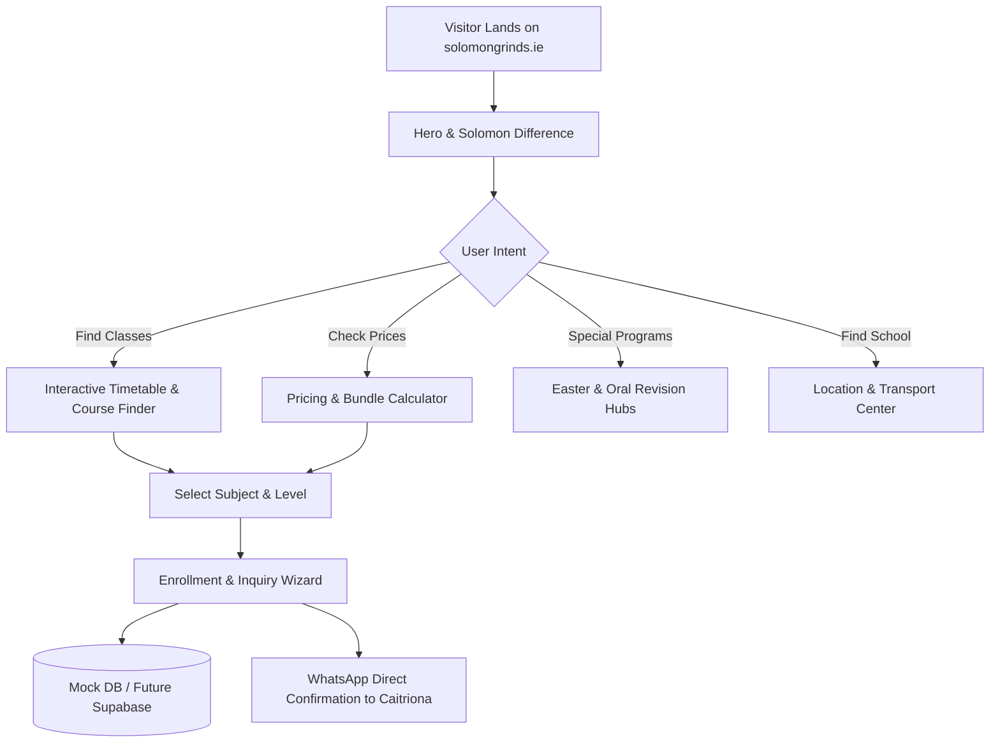
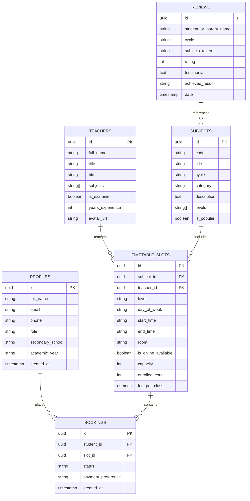

# Product Requirements Document (PRD)
## Project: Solomon Grinds — Modern Web Platform & Student Portal

* **Version:** 1.0.0
* **Date:** November 20, 2026
* **Status:** Approved for Implementation
* **Reference URL:** [https://solomongrinds.ie/](https://solomongrinds.ie/)
* **Target Audience:** Secondary School Students (Leaving Certificate & Junior Cycle), Parents & Guardians in West Dublin (Lucan, Palmerstown, Clondalkin) and North Kildare (Celbridge, Leixlip, Maynooth), and Administrative Staff.

---

## 1. Executive Summary & Website Audit

### 1.1 Background & Context
For over 25 years, **Solomon Grinds** has been an educational pillar in Lucan and the surrounding West Dublin / North Kildare regions. Operating primarily from Scoil Áine Naofa (opposite SuperValu on Newcastle Road, Lucan, just off the N4), Solomon Grinds provides specialized, exam-focused tuition for both the **Leaving Certificate** (5th & 6th Year) and **Junior Cycle** (1st to 3rd Year).

### 1.2 Current Website Audit (`solomongrinds.ie`)
An analysis of the existing website reveals high-quality educational value hidden beneath an outdated digital presence:

| Dimension | Current State (`solomongrinds.ie`) | Impact / Friction | Target Future State |
| :--- | :--- | :--- | :--- |
| **Visual Design** | Legacy 2000s web styling, dense plain text, low contrast, no cohesive modern brand identity. | Lacks academic prestige and credibility for modern discerning parents. | Modern, premium academic aesthetic ("Academic Excellence meets Warm Mentorship"). |
| **Mobile Experience** | Desktop-centric layouts; horizontal scrolling on timetable tables; difficult to touch targets. | Over 70% of parent/student traffic is mobile; high bounce rate. | Mobile-first responsive UI with bottom-sheet filters and finger-friendly cards. |
| **Course & Timetable Discovery** | Static, dense text blocks listing Wednesday and Saturday slots without filtering. | Frustrating search experience; parents cannot easily see conflicts or available slots. | Interactive Timetable Explorer with instant filtering by Cycle, Level, Subject, and Day. |
| **Pricing Transparency** | Pay-as-you-go rates (€20/class) and multi-subject discounts are buried in text. | Confusion regarding bundles and Easter Revision package costs. | Dynamic Interactive Bundle & Savings Calculator with clear transparent breakdown. |
| **Enrolment & Conversion** | Relies entirely on manual calls (`01 6284171`) or email (`caitrionahayes@yahoo.ie`). | Abandoned leads outside office hours; administrative burden on Caitriona Hayes. | Multi-step interactive booking wizard with WhatsApp direct routing and mock DB sync. |
| **Social Proof & Results** | Sparse testimonials and static text; no structured showcase of student grade increases. | Fails to communicate 25 years of proven results and high H1/H2 rates. | Results & Testimonials Hall of Fame with verified parent/student reviews. |
| **Location & Convenience** | Text-only address ("Newcastle Road, Lucan"); bus routes mentioned as plain text. | Misses the key selling point: avoiding tiring, expensive Dublin city-centre commutes. | Interactive Campus & Transit Map with real-time Dublin Bus route planner (C1, C2, C4, L51, L52, L53). |

---

## 2. Brand Positioning & The "Solomon Grinds Difference"

The new web platform is built around the core pillars that differentiate Solomon Grinds from large, impersonal commercial grinds schools in Dublin City Centre:

1. **Small Groups & Individual Attention:** Unlike city-centre grind factories with 50–100 students in lecture halls, Solomon Grinds caps classes to small, interactive cohorts where every student can ask questions and receive personal attention.
2. **Hand-Picked, Examiner-Level Faculty:** All teachers are hand-picked, highly experienced secondary school educators, and past or present State Examinations Commission (SEC) examiners. They know precisely where marking scheme marks are lost and gained.
3. **Safe, Convenient Suburban Location:** Situated at Scoil Áine Naofa, Lucan (adjacent to the N4, opposite SuperValu), eliminating the 90+ minute round-trip commute into Dublin city centre on weekday evenings or Saturday mornings.
4. **Flexible Pay-As-You-Go & Value Packages:** Standard fee of €20 per class with flexible pay-as-you-go terms, alongside attractive multi-subject bundles (e.g., 3 subjects for €55) and term-based discounts.
5. **Exam-Centric Synergy:** Supplementing, not replacing, day school learning with targeted exam strategies, concise revision notes, timing techniques, and language oral/aural mastery.
6. **Modern Hybrid Delivery:** In-person classroom grinds supplemented by online access for students unable to attend in person.

---

## 3. User Personas & User Journeys

### 3.1 Primary Personas

#### Persona A: "Stressed 6th Year Sarah" (Leaving Cert Student)
* **Demographics:** 17 years old, attends secondary school in Lucan/Celbridge.
* **Goal:** Aims for 520+ CAO points for Physiotherapy in UCD; struggling with Higher Maths calculus and Irish Oral confidence.
* **Frustrations:** Dreads commuting into Leeson Street or city centre on Saturdays; feels lost in large school classes.
* **Journey:** Visits site via mobile -> Filters timetable by "Leaving Cert" + "Higher Level" + "Maths" -> Explores teacher credentials -> Calculates bundle with Irish Oral -> Clicks "Book Free Trial / Save Seat via WhatsApp".

#### Persona B: "Conscientious Parent Mark" (Parent of Junior Cycle & Leaving Cert Students)
* **Demographics:** 48 years old, professional living in Lucan, working in Dublin.
* **Goal:** Wants structured, reliable academic support for his daughter (Junior Cycle Maths & Science) and son (6th Year Chemistry & English).
* **Frustrations:** Hates rigid upfront €1,500 term-lock fees; wants transparency, safe suburban parking, and proven examiner credentials.
* **Journey:** Lands on desktop -> Reads "The Solomon Grinds Difference" -> Uses Bundle Calculator (4 classes across 2 children) -> Views Scoil Áine Naofa location, parking & safety -> Submits inquiry form for Caitriona Hayes.

#### Persona C: "Administrator Caitriona Hayes" (Centre Director & Coordinator)
* **Goal:** Needs organized student inquiries, clear timetable management, and automated confirmation workflows to reduce repetitive phone inquiries.
* **Frustrations:** Answering the exact same timetable questions 40 times a day via SMS/WhatsApp.
* **Journey:** Receives structured lead notifications with student name, school year, selected subjects, preferred day, and contact information.

---

## 4. Product Features & Functional Requirements



### 4.1 Module 1: Navigation & Header Shell
* **Announcement Bar:** Dynamic banner for timely notices (e.g., *"Easter Revision 2027 Timetable Now Live — Limited Small Group Spaces Available"*).
* **Brand Identity:** High-resolution Solomon Grinds crest/logo with tagline *"Small Groups. Individual Attention. Proven Results."*
* **Navigation Links:**
  * Courses (Leaving Cert, Junior Cycle, 5th Year, Easter Revision, Oral Preparation)
  * Timetable Explorer
  * Fees & Calculator
  * Why Solomon (Our Difference, Teachers/Examiners, Results)
  * Location & Buses
  * Contact Us
* **Direct Actions:**
  * Phone Click-to-Call (`01 6284171`)
  * WhatsApp Direct Action (`087 2745234`)
  * CTA Button: **"Enrol / Reserve Seat"**

### 4.2 Module 2: Home Page Core Experience
* **Hero Section:**
  * Compelling headline: *"Master Your State Exams Without The City Centre Commute."*
  * Sub-headline emphasizing small groups, examiner-led classes, and individual attention in Lucan.
  * Dual CTAs: *"Explore Timetables"* (secondary/outline) and *"Book a Grind"* (primary glow).
  * Trust Proof Badges: *25+ Years Experience*, *100% Past/Present Examiners*, *Small Groups (<12 students)*, *Flexible Pay-As-You-Go*.
* **The Solomon Grinds Difference Grid:**
  * 4 interactive feature cards comparing Solomon Grinds vs typical city centre grind factories.
* **Quick Subject Matrix:**
  * Quick-pill selector toggling between **Leaving Certificate** and **Junior Cycle**.
  * Shows key subject tags (Higher Maths, English, Irish, French, Spanish, Chemistry, Biology, Physics, Business, Accounting, Computer Science).
* **Meet the Faculty Spotlight:**
  * Profiles of hand-picked teachers highlighting their years teaching, state examiner status, and subject specialties.
* **Results & Testimonial Wall:**
  * Verified quotes from local parents (Lucan, Celbridge, Palmerstown) with student university outcomes (Trinity, UCD, DCU, Maynooth).
* **Campus & Transit Section:**
  * Google Maps interactive preview of Scoil Áine Naofa.
  * Bus connection badges: **C1, C2, C4** (Direct Dublin Bus spine) and **L51, L52, L53** (Orbital feeder buses).
  * Travel time estimator: Lucan Village (3 mins), Celbridge (10 mins), Leixlip (8 mins), Palmerstown (7 mins).

### 4.3 Module 3: Interactive Timetable & Course Explorer
* **Faceted Search & Filters:**
  * **Academic Cycle:** All, Leaving Certificate (6th Year), 5th Year, Junior Cycle (3rd Year), 1st & 2nd Year.
  * **Level:** Higher, Ordinary.
  * **Subject Category:** STEM (Maths, Applied Maths, Physics, Chemistry, Biology, Computer Science), Languages (Irish, English, French, Spanish, German, Russian, Romanian), Business & Humanities (Accounting, Business, Economics, Geography, History, Politics & Society, Art).
  * **Day:** Wednesday Evenings (5:30 PM, 6:45 PM, 8:00 PM) vs Saturday (9:30 AM – 2:15 PM).
  * **Format:** In-Person (Scoil Áine Naofa), Online/Hybrid.
* **Timetable Views:**
  * **Grid View:** Visual weekly calendar matrix displaying Wednesday evening and Saturday daytime tracks.
  * **List / Card View:** High-density mobile-optimized cards detailing subject, level, teacher, time slot, room/online link, and seat status badge (*"Spaces Available"*, *"Few Seats Left"*, *"Waitlist"*).
* **Quick Action:** One-click *"Add to My Study Plan"* or *"Enrol in This Subject"*.

### 4.4 Module 4: Dynamic Pricing & Savings Bundle Calculator
* **Pay-As-You-Go Baseline:**
  * Standard individual class: **€20** per 1-hour session.
* **Multi-Subject Bundle Engine:**
  * Interactive slider or subject counter (1 to 5 subjects).
  * Pricing algorithm logic:
    * 1 Subject: €20 / class
    * 2 Subjects: €38 / class (Save €2/wk)
    * 3 Subjects: €55 / class (Special Bundle Rate — Save €5/wk)
    * 4+ Subjects: Additional discounted tier.
  * Sibling discount toggle (+10% off for families with multiple students enrolled).
* **Revision Course Pricing:**
  * Easter Revision packages (e.g., 1 Subject €140, 3 Subjects + 1 Free special package).
* **Summary Box:**
  * Dynamic weekly total, term total savings, and direct button *"Lock In This Bundle"*.

### 4.5 Module 5: Enrolment & Lead Capture Wizard
A 3-step lightweight, frictionless modal or dedicated flow:
* **Step 1: Student Information**
  * Student First & Last Name
  * Parent / Guardian Name & Contact (Phone, Email, WhatsApp preference)
  * Current School & Year (e.g., Lucan Community College, St. Joseph's Clondalkin, Coláiste Cois Life, Salesian College Celbridge, etc.)
* **Step 2: Subject & Schedule Selection**
  * Cycle (Leaving Cert or Junior Cycle)
  * Selected Subjects & Levels (multiselect with time clash indicator)
  * Preferred Attendance Mode: In-Person (Lucan) or Online
* **Step 3: Review & Submission**
  * Summary of chosen timetable slots and calculated fees.
  * Choice of action:
    1. **"Submit Enrolment Request"** (stores in mock DB + sends notification).
    2. **"Send via WhatsApp to Caitriona"** (pre-populates WhatsApp text with full booking summary).
  * Instant on-screen confirmation with next steps, venue directions, and contact details.

### 4.6 Module 6: Specialized Program Hubs

#### A. Easter Intensive Revision Courses
* Comprehensive 4-day intensive subject crash courses.
* Exam-focused booklets, past paper marking scheme dissections, and predicted question breakdowns.
* Timetable release, booking deadlines, and subject bundle offers (e.g., *Book 3 Subjects, Get 4th Free*).

#### B. Language Oral Preparation Intensive
* Targeted 1-on-1 and small group mock orals for **Leaving Cert Irish (Gaeilge), French, Spanish, and German**.
* 40% of Leaving Cert Irish marks allocated to the Oral Exam.
* Focus on sraithpictiúir, conversation fluency, grammar structures, and examiner marking rubrics.

#### C. Junior Cycle Exam Technique Clinics
* Supporting 3rd year students transitioning to SEC Junior Cycle Common Level & Higher Maths specifications.
* Classroom-based assessments (CBAs) and final exam paper mastery.

### 4.7 Module 7: Location, Campus & Commuter Guide
* Detailed directions for Scoil Áine Naofa, Newcastle Road, Lucan, K78 PF65 (opposite SuperValu Lucan).
* Parking details: Ample, secure on-site parking for parents dropping off and picking up.
* Public Transit matrix:
  * **C1 & C2:** Adamstown Station to Sandymount via Lucan Road.
  * **C4:** Maynooth to Ringsend via Lucan Road.
  * **L51 & L52:** Liffey Valley to Adamstown / Dodsboro.
  * **L53:** Liffey Valley to Hazelhatch.

---

## 5. Mock Data Architecture & Future Supabase Schema

The project will initially run using an in-memory / local JSON mock store that mirrors the exact relational schema planned for the Supabase PostgreSQL backend.



### 5.1 Schema Definition (TypeScript Interface)

```typescript
export type AcademicCycle = 'Junior Cycle' | 'Leaving Certificate' | '5th Year';
export type AcademicLevel = 'Higher' | 'Ordinary';
export type SubjectCategory = 'Languages' | 'STEM' | 'Business & Humanities';
export type DayOfWeek = 'Wednesday' | 'Saturday';

export interface Subject {
  id: string;
  code: string;
  title: string;
  cycle: AcademicCycle;
  category: SubjectCategory;
  levels: AcademicLevel[];
  description: string;
  isPopular?: boolean;
}

export interface Teacher {
  id: string;
  fullName: string;
  qualifications: string;
  role: string;
  bio: string;
  isExaminer: boolean;
  yearsExperience: number;
  subjects: string[];
  avatarUrl?: string;
}

export interface TimetableSlot {
  id: string;
  subjectId: string;
  subjectTitle: string;
  cycle: AcademicCycle;
  level: AcademicLevel;
  day: DayOfWeek;
  startTime: string; // e.g. "17:30"
  endTime: string;   // e.g. "18:30"
  room: string;      // e.g. "Room 4 - Scoil Áine Naofa"
  teacherId: string;
  teacherName: string;
  capacity: number;
  enrolledCount: number;
  feePerClass: number; // default €20.00
  isOnlineAvailable: boolean;
}

export interface BookingInquiry {
  id: string;
  studentName: string;
  parentName: string;
  parentPhone: string;
  parentEmail: string;
  currentSchool: string;
  cycle: AcademicCycle;
  slotIds: string[];
  totalWeeklyFee: number;
  notes?: string;
  status: 'PENDING' | 'CONFIRMED' | 'CONTACTED';
  createdAt: string;
}
```

---

## 6. Non-Functional Requirements

### 6.1 Performance & Core Web Vitals
* **Google Lighthouse:** 95+ across Performance, Accessibility, Best Practices, and SEO.
* **LCP (Largest Contentful Paint):** < 1.8s on 4G mobile networks.
* **CLS (Cumulative Layout Shift):** < 0.05.
* **FID / INP:** < 100ms response time on all interactive filters and calculators.

### 6.2 Accessibility (a11y)
* Full compliance with **WCAG 2.1 AA** standards.
* Contrast ratio of at least 4.5:1 for standard body text and 3:1 for large display headers against dark navy/emerald backgrounds.
* Semantic HTML5 elements (`<header>`, `<main>`, `<nav>`, `<section>`, `<article>`, `<aside>`).
* Full keyboard navigability (visible focus rings, skip-to-content links, Esc to dismiss modal wizards).
* ARIA attributes for dynamic filters, tab switches, and accordion FAQ panels.

### 6.3 Search Engine Optimization (SEO) & Local Dominance
* Structured JSON-LD metadata:
  * `EducationalOrganization` & `LocalBusiness` for Lucan, Co. Dublin.
  * `Course` schemas for Leaving Certificate and Junior Cycle subjects.
  * `FAQPage` schema for common questions.
* Localized target keywords:
  * *"Leaving Cert Grinds Lucan"*
  * *"Junior Cycle Maths Grinds West Dublin"*
  * *"Easter Revision Courses Lucan Celbridge Leixlip"*
  * *"Leaving Cert Irish Oral Preparation Dublin"*
  * *"Small group grinds Newcastle Road Lucan"*

### 6.4 Security & GDPR
* Clear consent checkboxes for parents when submitting student details.
* Transparent privacy policy detailing the handling of contact info strictly for grinds scheduling and administrative communications by Caitriona Hayes.
* No unsolicited marketing or data sharing with third parties.

---

## 7. Phased Implementation Roadmap

* **Phase 1 (Current Scope):**
  * Complete brand overhaul and modern UI component library.
  * Static & dynamic Next.js/React frontend with Tailwind CSS.
  * Rich local mock data store covering 25+ subjects, complete weekly timetable, pricing calculator, and faculty bios.
  * Client-side interactive filters, bundle calculator, and multi-step booking modal.
  * Automated WhatsApp click-to-chat generator with pre-formatted booking text.
* **Phase 2 (Supabase Backend):**
  * Connect PostgreSQL tables via Supabase client.
  * Authenticated Admin Portal for Caitriona Hayes to modify timetables, add Easter revision schedules, and export student enrollment rosters.
  * Direct email delivery via Resend / SendGrid.
* **Phase 3 (Student Portal & Payments):**
  * Integrated Stripe checkout for advance term bookings and Easter revision packs.
  * Student study dashboard with downloadable examiner notes and homework solution sets.
